<div align="center">
  <h1>AParte</h1>
  <p>Partes de servicio para técnicos: se rellenan en el móvil, el cliente firma en la pantalla y el PDF sale por email.</p>

  <p>
    
    
    
    
    
    
  </p>
  <p>
    <a href="https://github.com/DasikuHp/AParte/actions/workflows/test.yml"></a>
    
  </p>
</div>

La hice durante mis prácticas de 1.º de DAW para dos técnicos de una empresa de informática, que la usan para rellenar los partes desde el móvil. Con AParte el técnico apunta el cliente, las horas, el trabajo hecho y el material, saca fotos, el cliente firma con el dedo y la app genera el PDF y lo envía al cliente y a la oficina.

https://github.com/user-attachments/assets/74e59539-df02-4d9f-8a62-2420fc54f4bb

<sub>En el móvil, de principio a fin: entrar, rellenar el parte, añadir una foto, firmar, enviar y consultar el historial (modo demo, datos ficticios).</sub>

## Qué hace

| Inicio de sesión | Inicio del técnico | Historial |
| :---: | :---: | :---: |
| 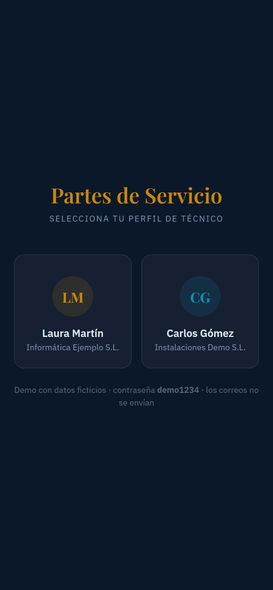 | 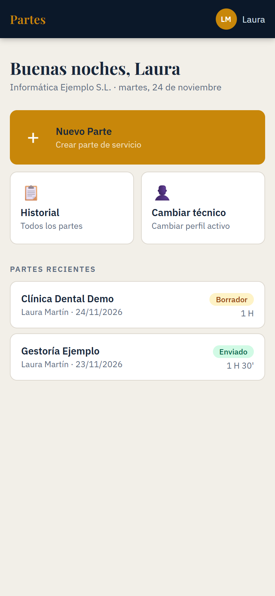 | 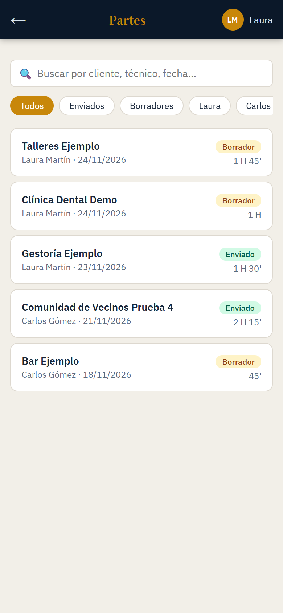 |
| Cada técnico entra con su contraseña. | Sus últimos partes, con el estado de cada uno. | Todos los partes, con búsqueda y filtros por estado o técnico. |

| Formulario | Material, fotos y firma | Vista previa |
| :---: | :---: | :---: |
| 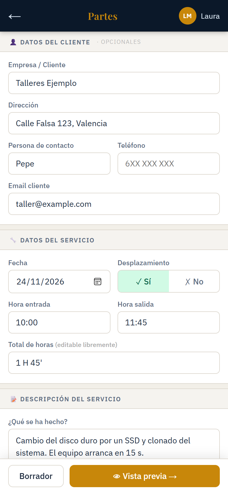 | 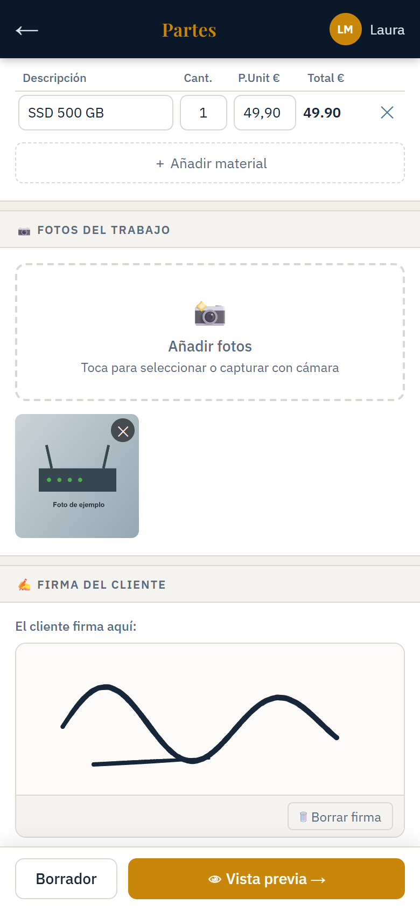 | 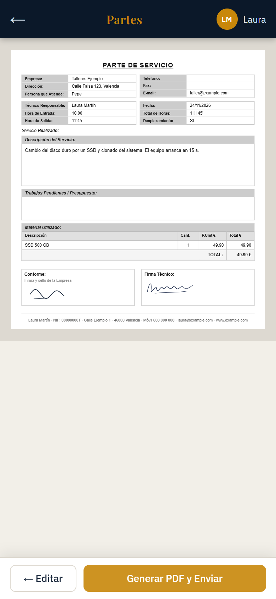 |
| Cliente, fecha, horas, desplazamiento y descripción. | El total del material se calcula solo. La firma se dibuja en un canvas. | El documento tal y como saldrá en el PDF. |

- Los partes se guardan como borrador y se pueden reabrir y corregir, también después de enviarlos.
- El PDF lleva la firma del cliente y la del técnico, que sale de su perfil.
- Un parte solo pasa a "Enviado" si el servidor de correo acepta el mensaje. Si falla, el PDF se descarga igualmente y el parte sigue como borrador.
- Cada técnico ve el historial de todos, pero solo puede editar, borrar o enviar sus propios partes. Los de un compañero se abren en modo consulta:

<div align="center">
  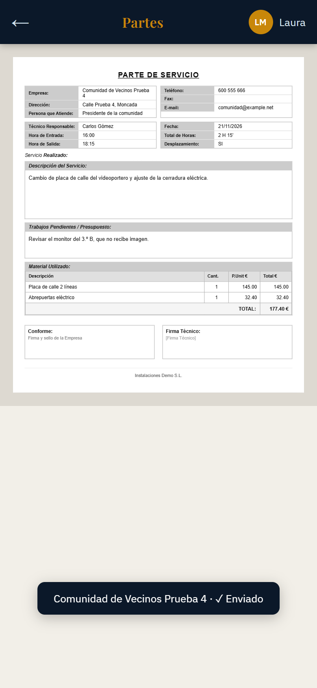
</div>

## En el ordenador

En la oficina el parte también se puede rellenar desde el ordenador. A partir de 760 px de ancho el formulario se queda en una columna centrada de 720 px, y la vista previa muestra el documento a tamaño real.

https://github.com/user-attachments/assets/2e294a61-c809-4eba-9c89-a77781bb3741

| Formulario | Vista previa |
| :---: | :---: |
| 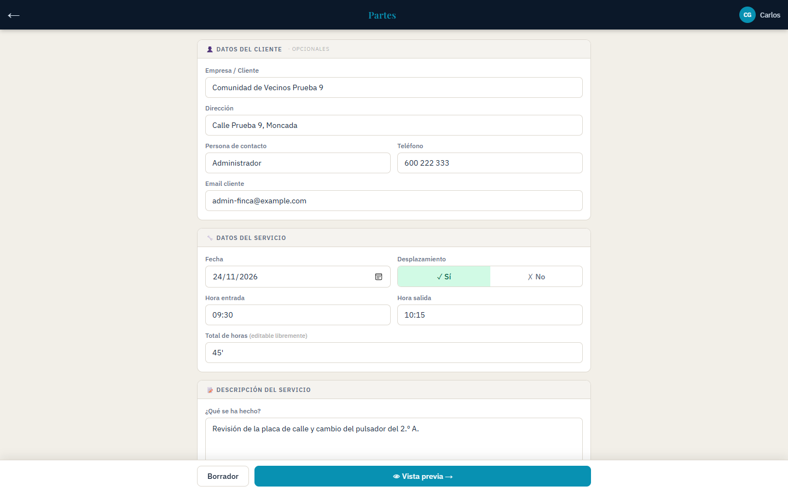 | 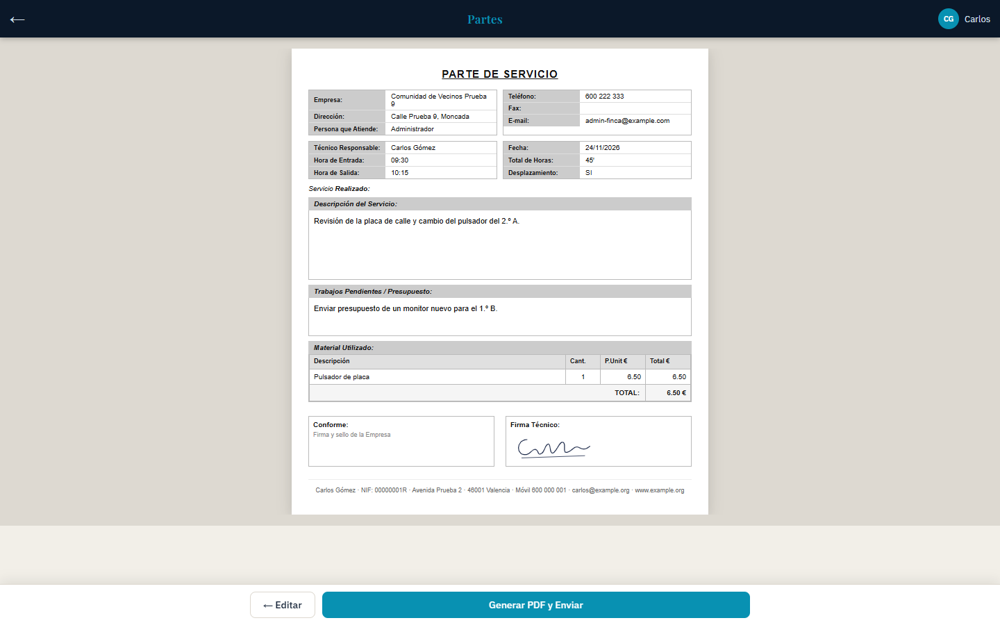 |

## Stack

| Parte | Tecnologías |
| :--- | :--- |
| Servidor | Node.js 22+, Express 4, `express-session`, `bcryptjs`, `helmet`, `express-rate-limit` |
| Base de datos | SQLite con el módulo nativo `node:sqlite` (sin dependencias) |
| Correo y ficheros | `nodemailer` (SMTP), `multer` (fotos) |
| Front | HTML, CSS y JavaScript sin framework; `signature_pad`, `html2canvas` y `jsPDF` desde CDN |
| Tests | `node:test` + `fetch`, GitHub Actions con Node 22 y 24 |

## Cómo funciona por dentro

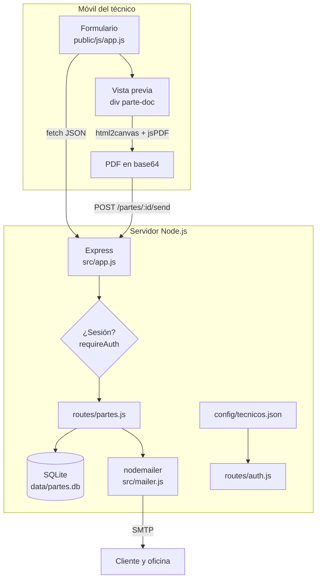

La app es una sola página (`public/partes.html`) con varias vistas: login, inicio, formulario, vista previa e historial. `showView()` en `public/js/app.js` oculta todas y muestra la que toca. No hay framework: el estado vive en un objeto `S` y cada vista se pinta con plantillas de texto (escapando lo que viene del usuario con `esc()` para evitar XSS).

El login compara la contraseña con un hash bcrypt guardado en `config/tecnicos.json`. Ese fichero no está en git: tiene el NIF, el móvil y la firma de cada técnico, y la API solo los entrega después del login (`GET /api/auth/me`). La sesión es una cookie `httpOnly` y `sameSite=lax` gestionada por `express-session`; al entrar se regenera el id de sesión y hay un límite de 10 intentos fallidos cada 15 minutos.

En el servidor, `src/routes/partes.js` traduce entre los nombres del front (`emailCliente`, `horaEntrada`...) y las columnas de SQLite (`email_cliente`, `hora_entrada`...) con una sola tabla, `FIELDS`. Todas las consultas son preparadas (`db.prepare(...).run(params)`), así que los datos nunca se concatenan en el SQL. El técnico de cada parte sale de la sesión, no del cuerpo de la petición, y antes de editar, borrar o enviar se comprueba que el parte es suyo.

El PDF se genera en el navegador. `html2canvas` "fotografía" el `div` de la vista previa y `jsPDF` mete esa imagen en un A4, por eso el PDF es una imagen y su texto no se puede seleccionar. El documento mide siempre 600 px de ancho; en el móvil se ve reducido con `transform: scale()`, y así el PDF sale igual desde cualquier pantalla. La firma del cliente es el dibujo del canvas guardado como PNG: sirve como "conforme" del cliente, pero no es una firma electrónica con certificado.

<div align="center">
  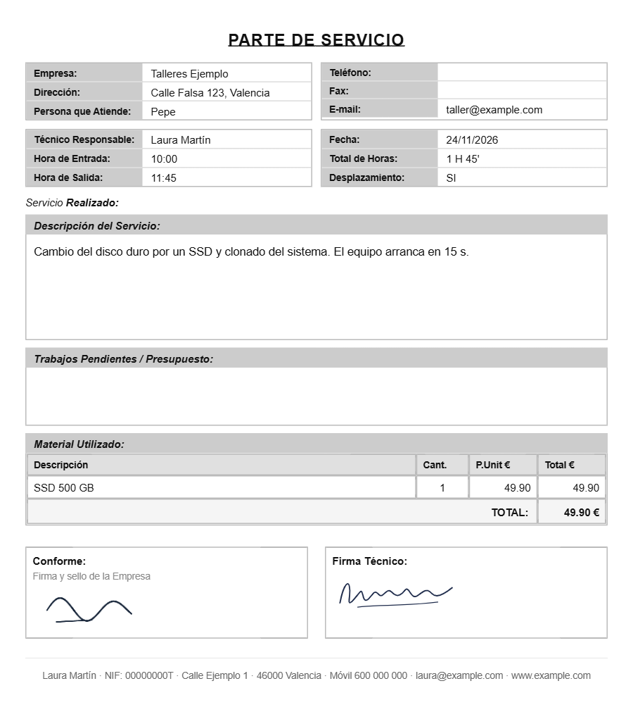
  <p><sub>La imagen que acaba dentro del PDF.</sub></p>
</div>

Para enviar, el front guarda el parte, genera el PDF y llama a `POST /api/partes/:id/send`. El servidor valida los emails, manda el correo con el PDF adjunto y, solo si `nodemailer` no da error, guarda el PDF y marca el parte como enviado. Sin SMTP configurado (o en modo demo) el correo se simula y la interfaz lo avisa.

La base de datos se crea y se actualiza sola al arrancar (`src/db/index.js`). Cada cambio de esquema es una migración numerada y `PRAGMA user_version` guarda cuál fue la última aplicada; la segunda migración, por ejemplo, pasa las fechas antiguas de `dd/mm/aaaa` a `aaaa-mm-dd` sin perder partes.

Otras medidas de seguridad: cabeceras con `helmet` y una Content Security Policy que solo permite los CDN que usa la página; las fotos solo pueden ser JPEG, PNG o WebP de hasta 8 MB, se guardan con un nombre aleatorio y solo se sirven con sesión iniciada; y los errores internos no se devuelven al cliente.

## Estructura del proyecto

```text
AParte
├── config/
│   ├── tecnicos.example.json   Técnicos de ejemplo (contraseña demo1234)
│   └── firmas/                 Firmas de ejemplo en SVG
├── public/
│   ├── partes.html             HTML y CSS de todas las vistas
│   └── js/app.js               Lógica del front
├── src/
│   ├── index.js                Arranque del servidor
│   ├── app.js                  Express: middlewares, rutas y errores
│   ├── config.js               Lee las variables de entorno
│   ├── tecnicos.js             Carga config/tecnicos.json
│   ├── mailer.js               SMTP real o simulado
│   ├── middleware/auth.js      Sesión y requireAuth
│   ├── routes/auth.js          Login, logout, perfil y lista de técnicos
│   ├── routes/partes.js        CRUD de partes, envío y subida de fotos
│   ├── db/                     Esquema y migraciones de SQLite
│   └── scripts/                seed.js (datos de ejemplo) y hash.js (contraseñas)
├── test/api.test.js            Tests de la API
└── docs/media/                 Capturas y GIF de este README
```

## Instalación

Hace falta Node.js 22.13 o posterior (por `node:sqlite`).

```bash
git clone https://github.com/DasikuHp/AParte.git
cd AParte
npm install
```

Para probarla con datos ficticios, sin configurar nada:

```bash
DEMO_MODE=true npm start          # en PowerShell: $env:DEMO_MODE="true"; npm start
```

Abre `http://localhost:3000`, elige un técnico y entra con `demo1234`. Los correos no se envían.

Para usarla de verdad:

```bash
cp .env.example .env                             # y rellena SESSION_SECRET y el SMTP
cp config/tecnicos.example.json config/tecnicos.json
npm run hash -- LaContraseñaDelTécnico           # pega el resultado en passwordHash
npm start
```

## Variables de entorno

| Variable | Para qué sirve | Por defecto |
| :--- | :--- | :--- |
| `PORT` | Puerto del servidor | `3000` |
| `SESSION_SECRET` | Clave para firmar la cookie de sesión. Obligatoria en producción | aleatoria en desarrollo |
| `DEMO_MODE` | `true`: técnicos de ejemplo, partes ficticios y correo simulado | `false` |
| `TECNICOS_FILE` | Fichero con los técnicos | `config/tecnicos.json` |
| `DB_PATH` | Base de datos SQLite | `data/partes.db` |
| `UPLOADS_DIR` | Carpeta de las fotos | `uploads/` |
| `COOKIE_SECURE` / `TRUST_PROXY` | Cookies solo por HTTPS detrás de un proxy (Nginx, Render...) | `true` si `NODE_ENV=production` |
| `SMTP_HOST`, `SMTP_PORT`, `SMTP_SECURE`, `SMTP_USER`, `SMTP_PASS`, `SMTP_FROM` | Servidor de correo. Si `SMTP_HOST` está vacío, el correo se simula | vacío |

## API

Todas las rutas van bajo `/api` y, salvo las tres primeras, piden sesión.

| Método | Ruta | Qué hace |
| :---: | :--- | :--- |
| `GET` | `/tecnicos` | Nombre, iniciales, empresa y color de cada técnico (para el login) |
| `POST` | `/auth/login` | `{ tech, password }`. Crea la sesión y devuelve el perfil |
| `GET` | `/auth/me` | Perfil del técnico conectado |
| `POST` | `/auth/logout` | Cierra la sesión |
| `GET` | `/partes?tech=&status=&q=` | Lista de partes (sin PDF ni firma) |
| `GET` | `/partes/:id` | Un parte completo, con `editable` si es tuyo |
| `POST` | `/partes` | Crea un borrador |
| `PUT` | `/partes/:id` | Modifica un parte propio |
| `DELETE` | `/partes/:id` | Borra un parte propio |
| `POST` | `/partes/:id/send` | `{ para, cc, pdfBase64, filename }`. Envía el PDF; 502 si falla el correo |
| `GET` | `/partes/:id/pdf` | PDF del último envío |
| `POST` | `/upload` | Sube una foto (`multipart/form-data`, campo `file`) |

```bash
# Ejemplo con curl en el modo demo
curl -c cookies.txt -H "Content-Type: application/json" \
  -d '{"tech":"laura","password":"demo1234"}' http://localhost:3000/api/auth/login
curl -b cookies.txt "http://localhost:3000/api/partes?status=sent"
```

## Tests

```bash
npm test
```

Los 11 tests de `test/api.test.js` levantan la app con una base de datos en memoria y un correo falso, y comprueban, entre otras cosas, que un parte reabierto conserva todos sus campos, que un técnico no puede tocar los partes de otro, que un fallo del SMTP deja el parte como borrador, que no se pueden subir ficheros que no sean imágenes y que la migración conserva los partes antiguos. GitHub Actions los pasa en cada push con Node 22 y 24.

## Limitaciones

- Las sesiones se guardan en memoria: al reiniciar el servidor hay que volver a entrar, y no sirve para varias instancias a la vez.
- Necesita internet para cargar `jsPDF`, `html2canvas`, `signature_pad` y las fuentes desde sus CDN.
- El PDF es una imagen, así que su texto no se puede copiar ni buscar.
- Los técnicos se dan de alta editando `config/tecnicos.json`; no hay panel de administración.
- Si se quita una foto de un parte, el fichero se queda en `uploads/`.

## Licencia

[Business Source License 1.1](LICENSE). Puedes leer, copiar y modificar el código y usarlo fuera de producción. El uso comercial necesita permiso; el 27 de marzo de 2030 pasa a Apache 2.0. Contacto: [dasikuhp@gmail.com](mailto:dasikuhp@gmail.com).

<div align="center">
  <sub>Hecho por <a href="https://github.com/DasikuHp">DasikuHp</a> · versión 1.1.0</sub>
</div>
